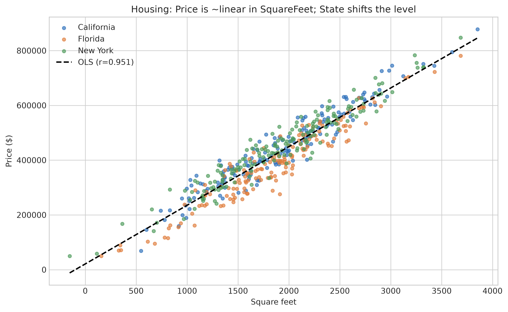

<!-- ascii-art: pyfiglet + ascii-bin (CC0) -->
```text
           _
 _ __ ___ | |
| '_ ` _ \| |
| | | | | | |
|_| |_| |_|_|

╭─────────────────────────────────────────────────────────────────────────╮
│ Пайплайн из курса ML A-Z легко испортить незаметно: импутеры и энкодеры │
╰─────────────────────────────────────────────────────────────────────────╯
━━━━━━━━━━━━━━━━━━━━━━━━━━━━━━━━━━━━━━━━━━━━━━━━━━━━━━━━━━━━━━━━━━━━━━━━━━━
```

# ML Fundamentals

> Пайплайн из курса Machine Learning A-Z на scikit-learn: препроцессинг без
> утечки данных (импутация → масштабирование → one-hot), обученный только на
> тренировочной части. **21 тест**, Train (8, 5) / Test (2, 5).

**Public link:** [демо](https://nikitaboyarkin.github.io/demos/ml/index.html) · [кейс](https://nikitaboyarkin.github.io/projects/ml/) · [исходники](https://github.com/NikitaBoyarkin/ml)

## Навигация
- 🌐 [Сайт-портфолио](https://nikitaboyarkin.github.io)
- 🏦 [Флагманский кейс: необанк Volta](https://github.com/NikitaBoyarkin/volta-banking)
- 🧪 Рядом: [churn-prediction](https://github.com/NikitaBoyarkin/churn-prediction) · [python](https://github.com/NikitaBoyarkin/python) · [sql-analytics-case-study](https://github.com/NikitaBoyarkin/sql-analytics-case-study)

**▶ [Схема: препроцессинг в scikit-learn без утечки данных](docs/diagrams/ml.html)** — открывается в браузере, ничего ставить и собирать не нужно

**На этой странице:** [Ситуация](#ситуация) · [Задача](#задача) · [Решение](#решение) · [Действия](#действия) · [Результат](#результат) · [Что делает](#что-делает) · [Структура](#структура) · [Запуск](#запуск) · [Тесты](#тесты) · [Заметки](#заметки)

## Ситуация

Пайплайн из курса ML A-Z легко испортить незаметно: импутеры и энкодеры
подглядывают в тестовую выборку, сплит зависит от случайного зерна, а API
scikit-learn уже устарели. Смысл проекта — **сам пайплайн**, сделанный
правильно и на современных инструментах.

## Dataset

Смешанные данные. `data/` — шесть датасетов курса Machine Learning A-Z
(`Data.csv`, `Salary_Data.csv`, `50_Startups.csv`, `Position_Salaries.csv`,
`Social_Network_Ads.csv`, `Mall_Customers.csv`) и четыре синтетических набора на
400 / 300 / 500 / 800 строк, построенных по их схеме. Синтетика детерминирована:
`python/generate_dummy_data.py`, RNG с фиксированным зерном — `cd python && python3 generate_dummy_data.py`
пересобирает файлы, поэтому сплит, тесты и графики EDA воспроизводятся один в один.

## Задача

Собрать препроцессинг как надо: заполнить пропуски, закодировать категории,
разделить данные детерминированно и отмасштабировать признаки так, чтобы
информация из теста не попадала в обучение.

## Решение

Брать отсюда **шаблон препроцессинга**, а не результат модели: связка
`SimpleImputer` → `StandardScaler` / `OneHotEncoder` в одном `ColumnTransformer`,
обученном только на тренировочной части, переносится в любой проект на
scikit-learn. Все числа проекта — процессные: 21 тест проверяет поведение кода и
защиту от утечки, размеры сплита подтверждают детерминированность, `dpi` — качество
картинки; ни одно из них не измеряет качество предсказаний, поэтому на них нельзя
обосновать продуктовое решение. Граница применимости — заполнение пропусков средним:
на этой синтетике оно безвредно, но там, где сам факт пропуска информативен
(данные MNAR), средняя подставит ложный сигнал.

## Действия

Шаги пайплайна (`SimpleImputer`, `OneHotEncoder` / `LabelEncoder`, детерминированный
сплит, `StandardScaler`) и вспомогательные скрипты разобраны по файлам ниже —
в разделе [Что делает](#что-делает).

## Результат

- **21 тест** — в `tests/` (7 в `test_data_preprocessing` + 9 в `test_eda_plots` + 5 в `test_generate_dummy_data`).
- **Train (8, 5) / Test (2, 5)** — детерминированный сплит 80/20, который печатает `python/data_preprocessing.py`.
- **400 / 300 / 500 / 800** — сгенерированных строк в `Data_large`, `Salary_Data_large`, `Housing_Data`, `Customer_Churn`.
- **300 dpi** — графики EDA в `output/`: по одной фигуре на датасет плюс общий `dashboard.png` (`python/eda_plots.py`).

## Что делает

Практическая реализация пайплайна из курса **Machine Learning A-Z** на Python
(scikit-learn). Начинается с препроцессинга (часть 1) — фундамента, на котором
стоят регрессия, классификация и кластеризация.

**`python/data_preprocessing.py`** — препроцессинг `Data.csv`:

- **Пропуски**: заполнение средним через `SimpleImputer`.
- **Категории**: `OneHotEncoder` для признаков, `LabelEncoder` для целевой
  переменной.
- **Сплит**: детерминированные 80/20 — строки устойчиво сортируются по
  `(Country, Age)`, каждая пятая уходит в тест. Случайное зерно не нужно.
- **Масштабирование**: `StandardScaler` только на числовых столбцах.

Всё собрано в один пайплайн `ColumnTransformer` (`SimpleImputer` →
`StandardScaler` для чисел, `OneHotEncoder` для категорий) и обучено **только
на тренировочной части**, поэтому тест не протекает в препроцессинг.

**`python/generate_dummy_data.py`** — детерминированный генератор (RNG с
зерном) для дополнительных датасетов в `data/`, по одному на этап пайплайна:

| Файл | Образец | Назначение |
|------|---------|------------|
| `Data_large.csv` | `Data.csv` | 400 строк, расширенный набор для препроцессинга |
| `Salary_Data_large.csv` | `Salary_Data.csv` | 300 строк, простая линейная регрессия |
| `Housing_Data.csv` / `.sql` | `50_Startups.csv` | 500 строк, множественная регрессия |
| `Customer_Churn.csv` / `.json` | `Social_Network_Ads.csv` | 800 строк, классификация |

**`python/eda_plots.py`** — графики EDA по каждому датасету в `output/`
(одна фигура на датасет плюс общий `dashboard.png`). Единый стиль
`dark_background`, объектный matplotlib (`fig, ax = plt.subplots`), PNG 300 dpi.



*Цена жилья против площади (`reports/eda/`, набор `Housing_Data.csv`) — связь линейная,
и это формула генератора, а не найденная закономерность рынка; график подтверждает
постановку множественной регрессии. Отдельный артефакт от `output/` из `python/eda_plots.py`.*

## Структура

```
ml/
├── data/              # 6 датасетов курса + сгенерированные крупные наборы
│   ├── Data.csv              # Часть 1 — препроцессинг (France/Spain/Germany)
│   ├── Salary_Data.csv       # Часть 2 — простая линейная регрессия
│   ├── 50_Startups.csv       # Часть 2 — множественная линейная регрессия
│   ├── Position_Salaries.csv # Часть 2 — полином / SVR / деревья
│   ├── Social_Network_Ads.csv# Часть 3 — классификация
│   ├── Mall_Customers.csv    # Часть 4 — кластеризация
│   └── Data_large.csv, Salary_Data_large.csv, Housing_Data.csv,
│       Housing_Data.sql, Customer_Churn.csv, Customer_Churn.json
├── python/           # data_preprocessing.py, generate_dummy_data.py, eda_plots.py
├── output/           # сгенерированные графики EDA (в gitignore)
└── tests/            # дымовые тесты на pytest
```

## Запуск

```bash
# Python 3.14+ (pyproject.toml: requires-python = ">=3.14", .python-version = 3.14);
# зафиксированные версии зависимостей — uv.lock
uv sync                                   # или без uv: pip install -r requirements.txt

# препроцессинг (читает ../data/Data.csv относительно python/)
cd python
python3 data_preprocessing.py

# пересобрать синтетические датасеты (запускать из python/)
python3 generate_dummy_data.py

# отрисовать все графики EDA в output/ (из корня проекта)
python python/eda_plots.py

# отрисовать фигуры EDA-отчёта в reports/eda/figures/ (в т.ч. fig3_price_vs_sqft.png)
python reports/eda/scripts/plot_figures.py
```

## Тесты

```bash
pip install pytest
pytest
```

## Заметки

- Переехали на современный scikit-learn: `sklearn.model_selection`,
  `sklearn.impute.SimpleImputer`, `ColumnTransformer`. Исходные
  `sklearn.cross_validation` / `Imputer` / `OneHotEncoder(categorical_features=)`
  из курса удалены в scikit-learn ≥ 0.22.
- Печатает `Train: (8, 5), Test: (2, 5)`.
